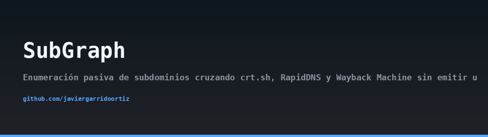
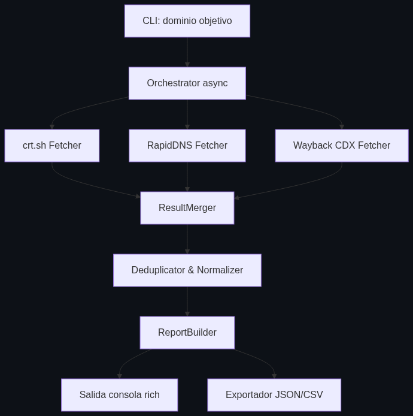
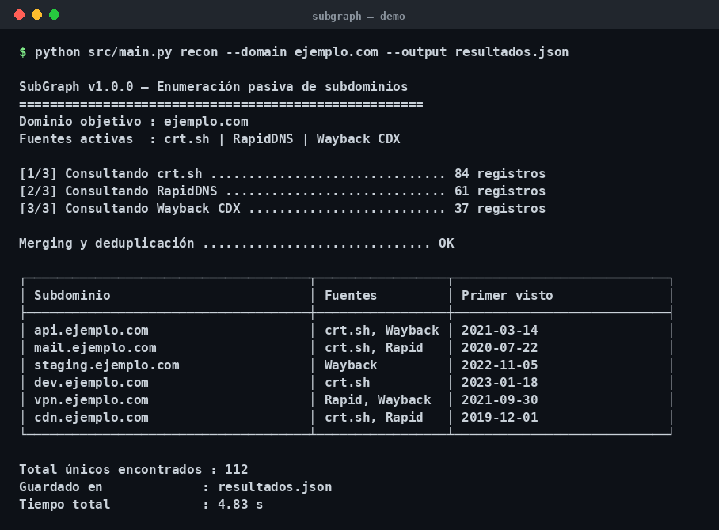
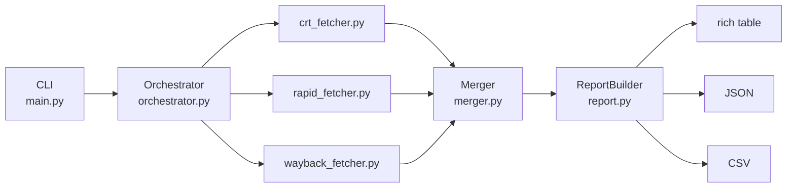

## Architecture



## Demo



> 🇪🇸 Lee esto en [español](README.md).

# SubGraph

[](https://www.python.org/downloads/)
[](LICENSE)
[](tests/)
[](#responsible-use)

Passive subdomain enumeration by cross-referencing **crt.sh**, **RapidDNS** and the **Wayback Machine** without emitting a single packet towards the target.

## Description

SubGraph is a passive reconnaissance tool that aggregates subdomain data from three public, third-party sources and consolidates the results into a single, deduplicated view. It never resolves DNS records, never opens a TCP connection to the target and never sends an HTTP request to the domain under analysis. All queries are directed to public certificate transparency logs, passive DNS aggregators and web archives.

The tool is designed for red teams, bug bounty hunters and blue teams that need a fast, quiet and reproducible inventory of an organization's external surface.

## Motivation

Active enumeration (brute force, zone transfers, DNS resolution) leaves traces in the target's logs and can be detected by WAFs, IDS/IPS and SIEM correlation rules. Passive sources, on the other hand, are public by design: certificate transparency logs are append-only ledgers mandated by CAs, RapidDNS aggregates historical passive DNS data, and the Wayback Machine archives crawled URLs. Cross-referencing them dramatically improves coverage while keeping a zero-footprint profile against the target.

SubGraph was built to solve three common pain points:

- **Fragmented sources**: each provider returns a different shape and different metadata. SubGraph normalizes them into a single `SubdomainRecord` model.
- **Duplicate noise**: the same FQDN appears in multiple sources with different casing, wildcards and timestamps. The merger collapses them and preserves the union of sources plus the earliest `first_seen`.
- **Reproducibility**: JSON and CSV output make results easy to diff between runs and to feed into downstream pipelines.

## Architecture



SubGraph is organized in five layers:

1. **CLI** (`src/main.py`): argparse-based entry point exposing `recon` and `sources` commands, plus `--domain`, `--sources`, `--output` and `--format` flags.
2. **Fetchers** (`src/fetchers/`): three independent async coroutines, one per source, each returning a list of `SubdomainRecord`.
3. **Orchestrator** (`src/orchestrator.py`): launches all fetchers concurrently with `asyncio.gather()` and forwards results to the merger.
4. **Merger** (`src/merger.py`): normalizes FQDNs (lowercase, no wildcards, no duplicates) and unifies records sharing the same key by unioning sources and keeping the oldest `first_seen`.
5. **ReportBuilder** (`src/report.py`): renders the consolidated list as a `rich` table on the console and as JSON/CSV files.

The central data model is `SubdomainRecord` (pydantic 2):

```python
class SubdomainRecord(BaseModel):
    fqdn: str
    sources: list[str]
    first_seen: Optional[str] = None
```

## Installation

Requires Python 3.11 or newer.

```bash
git clone https://github.com/javiergarrido/subgraph.git
cd subgraph
python -m venv .venv
source .venv/bin/activate
pip install -r requirements.txt
```

Optional environment variables:

| Variable | Description | Default |
| --- | --- | --- |
| `SUBGRAPH_TIMEOUT` | HTTP timeout in seconds | `15` |
| `SUBGRAPH_RETRIES` | Retry attempts per source | `3` |
| `SUBGRAPH_USER_AGENT` | User-Agent header sent to public APIs | `SubGraph/1.0` |

No credentials are required: all three sources are publicly accessible.

## Usage

List available sources:

```bash
python -m src.main sources
```

Run a full reconnaissance against a domain and print a rich table:

```bash
python -m src.main recon --domain example.com
```

Restrict to two sources and export JSON:

```bash
python -m src.main recon --domain example.com \
    --sources crt,wayback \
    --format json \
    --output results/example.json
```

Export CSV for spreadsheet analysis:

```bash
python -m src.main recon --domain example.com --format csv --output example.csv
```

Example console output:

```
┏━━━━━━━━━━━━━━━━━━━━━━━━━━━━┳━━━━━━━━━━━━━━━━━━━━━━━━━┳━━━━━━━━━━━━┓
┃ FQDN                       ┃ Sources                 ┃ First seen ┃
┡━━━━━━━━━━━━━━━━━━━━━━━━━━━━╇━━━━━━━━━━━━━━━━━━━━━━━━━╇━━━━━━━━━━━━┩
│ api.example.com            │ crt, rapid, wayback     │ 2019-04-12 │
│ mail.example.com           │ crt, rapid              │ 2020-08-01 │
│ staging.example.com        │ wayback                 │ 2021-11-23 │
└────────────────────────────┴─────────────────────────┴────────────┘
```

## MITRE ATT&CK

SubGraph maps to the following techniques of the Reconnaissance tactic:

- **T1596 — Search Open Technical Databases**: queries certificate transparency logs (crt.sh), passive DNS aggregators (RapidDNS) and web archives (Wayback Machine CDX API) to discover infrastructure associated with a target.
- **T1597 — Search Closed Sources**: the aggregated output can be enriched with internal or commercial datasets (paid passive DNS, threat intel feeds) without modifying the fetcher layer, since the merger accepts any source label.

Both techniques are passive by nature and do not generate traffic towards the victim's infrastructure.

## Responsible Use

SubGraph is intended **exclusively** for authorized security assessments, bug bounty programs that explicitly permit passive reconnaissance, and defensive asset inventory. You are responsible for complying with the terms of service of crt.sh, RapidDNS and the Internet Archive, as well as with any applicable legislation in your jurisdiction.

The authors do not condone the use of this tool against systems you do not own or do not have written permission to test. Because SubGraph never contacts the target, it does not perform any intrusive action; however, the resulting inventory is sensitive and should be handled accordingly.

## License

Released under the MIT License. See [LICENSE](LICENSE) for the full text.

Author: **Javier Garrido Ortiz**
