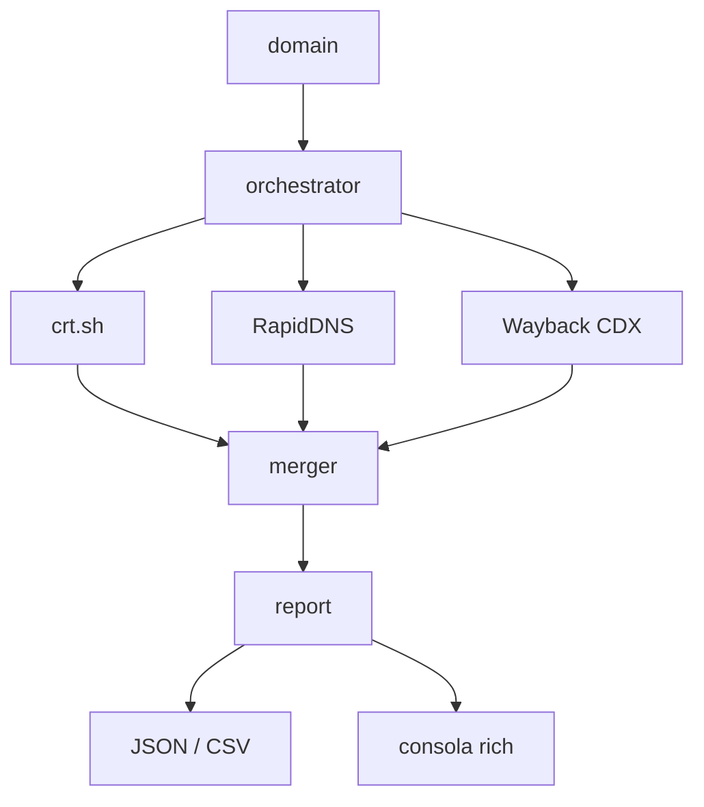

## Arquitectura


## Demo


> 🇬🇧 Read this in [English](README.en.md).

# SubGraph


## Descripción

SubGraph es una herramienta de **enumeración pasiva de subdominios** que cruza información de tres fuentes públicas: [crt.sh](https://crt.sh), [RapidDNS](https://rapiddns.io) y la [Wayback Machine CDX API](https://web.archive.org/cdx/search/cdx). Su objetivo es descubrir subdominios asociados a un dominio raíz **sin emitir un solo paquete activo contra el objetivo**.

A diferencia de herramientas como `amass`, `subfinder` o `dnsx` cuando operan en modo activo, SubGraph nunca realiza consultas DNS directas ni conexiones TCP al dominio investigado. Todo el conocimiento se obtiene de registros históricos y bases de datos técnicas ya publicadas por terceros.

Esto la convierte en una herramienta ideal para fases iniciales de reconocimiento OSINT, auditorías con requisitos de sigilo, o entornos donde el escaneo activo está contractualmente restringido.

## Motivación

En el ciclo de vida de un test de intrusión, el reconocimiento pasivo y el activo tienen propósitos distintos:

- **Reconocimiento pasivo**: se consultan fuentes de terceros (registros CT, archivos históricos, motores de búsqueda). El objetivo no recibe tráfico, no ve las consultas en sus logs y no puede correlacionar la actividad con un actor concreto.
- **Reconocimiento activo**: se envían consultas DNS, peticiones HTTP o escaneos de puertos al objetivo. Es más completo, pero deja huella.

SubGraph se centra exclusivamente en el primer caso. La superficie de subdominios que se puede descubrir pasivamente suele ser sorprendentemente amplia: los Certificate Transparency logs exponen cada certificado emitido para un dominio, y la Wayback Machine conserva URLs indexadas durante años.

## Arquitectura



El flujo es el siguiente:

1. El CLI recibe un dominio y una lista de fuentes.
2. El `Orchestrator` lanza los fetchers seleccionados en paralelo con `asyncio.gather()`.
3. Cada fetcher devuelve una lista de `SubdomainRecord`.
4. El `Merger` normaliza los FQDN (minúsculas, sin wildcards, sin duplicados) y unifica registros con la misma clave, acumulando las fuentes que lo detectaron y conservando el `first_seen` más antiguo.
5. El `ReportBuilder` genera la salida en formato tabla (rich), JSON o CSV.

## Instalación

Requisitos: Python 3.11 o superior.

```bash
git clone https://github.com/javiergarrido/subgraph.git
cd subgraph
python -m venv .venv
source .venv/bin/activate   # En Windows: .venv\Scripts\activate
pip install -r requirements.txt
```

## Uso

Ejecución completa contra un dominio, guardando la salida en JSON:

```bash
python src/main.py recon --domain ejemplo.com --output resultado.json
```

Salida en formato CSV por consola:

```bash
python src/main.py recon --domain ejemplo.com --format csv
```

Listar las fuentes disponibles y su estado:

```bash
python src/main.py sources
```

Seleccionar fuentes concretas:

```bash
python src/main.py recon --domain ejemplo.com --sources crt,wayback
```

### Flags principales

| Flag | Descripción |
| --- | --- |
| `--domain` | Dominio raíz a investigar (obligatorio en `recon`). |
| `--sources` | Lista separada por comas: `crt`, `rapid`, `wayback`. Por defecto, todas. |
| `--output` | Ruta del fichero de salida. |
| `--format` | `json`, `csv` o `table` (por defecto `table`). |

## MITRE ATT&CK

SubGraph cubre técnicas de reconocimiento pasivo dentro de la táctica **Reconnaissance (TA0043)**:

- **T1596 — Search Open Technical Databases**: consulta de Certificate Transparency logs (crt.sh) y archivos históricos (Wayback CDX).
- **T1597 — Search Closed Sources**: uso de bases de datos agregadas de terceros (RapidDNS) que recopilan información de subdominios ya indexada.

Ambas técnicas se ejecutan sin interacción directa con la infraestructura del objetivo.

## Aviso Legal y Uso Responsable

SubGraph **solo consulta fuentes públicas**. No realiza resolución DNS, no abre conexiones al dominio investigado y no envía tráfico alguno hacia la infraestructura del objetivo.

Aun así, el uso de esta herramienta debe realizarse únicamente sobre dominios para los que el usuario tenga autorización expresa por escrito. El autor no se hace responsable del uso indebido del software. Consulta siempre la legislación aplicable en tu jurisdicción antes de ejecutar cualquier tarea de reconocimiento, incluso si es pasiva.

## Licencia

Este proyecto se distribuye bajo la licencia MIT. Consulta el fichero [LICENSE](LICENSE) para el texto completo.

Copyright (c) Javier Garrido Ortiz.
